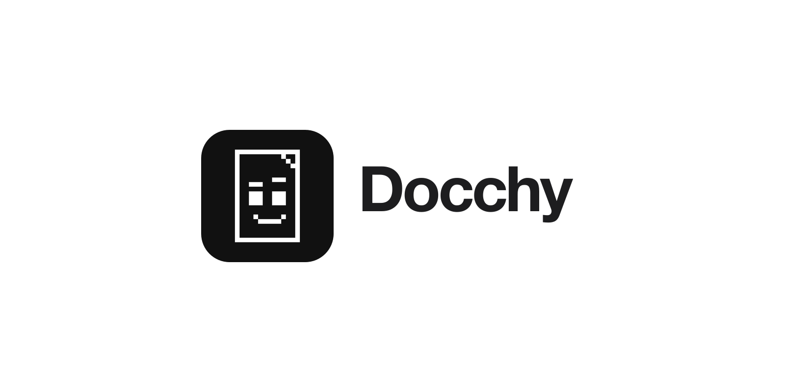

# 📑 Docchy — Private Document Scanner & Organizer

## 📱 Overview

Docchy is a privacy-first iOS document scanner built entirely with SwiftUI. It helps users scan, organize, search, and protect their documents in one simple, elegant place.

From receipts and notes to important documents with expiration dates, Docchy turns paper into searchable PDFs while keeping every scan and analysis on the device.

## ✨ Features

- 📄 Scan single- or multi-page documents with the device camera
- 🗂️ Save scanned pages as high-quality PDF files
- 🔎 Recognize text on-device with OCR and search documents by title or content
- 📅 Detect expiration dates and schedule local reminders
- 🖼️ Preview, share, and export PDFs as JPEG or PNG images
- 🔐 Protect access to the app with Face ID or Touch ID
- ✏️ Rename, organize, and quickly browse your document library
- 💬 Get help from Docchy’s built-in assistant and onboarding experience

## 🔒 Privacy

Docchy is designed with privacy at its core.

All documents, PDFs, OCR results, and reminders are created and stored locally on the device. Text recognition runs on-device and Docchy does not require an account, subscription, or external server connection.

> [!IMPORTANT]
> Docchy helps you digitize and organize documents, but it is not a substitute for secure backups. Keep copies of important documents in a safe location.

## 📦 Technologies Used

- **SwiftUI** — User interface
- **SwiftData** — Local document metadata storage
- **VisionKit** — Document camera scanning
- **Vision** — On-device text recognition (OCR)
- **PDFKit** — PDF creation, rendering, and export
- **LocalAuthentication** — Face ID / Touch ID protection
- **UserNotifications** — Local expiration reminders

## 🚀 Getting Started

1. Clone the repository.
2. Open `Docchy.xcodeproj` in Xcode.
3. Select an iPhone running iOS 17.6 or later.
4. Build and run the app.

> A physical device is recommended to use document scanning and biometric authentication.

## 📄 License

This project is licensed under the terms of the [MIT License](./LICENSE).
